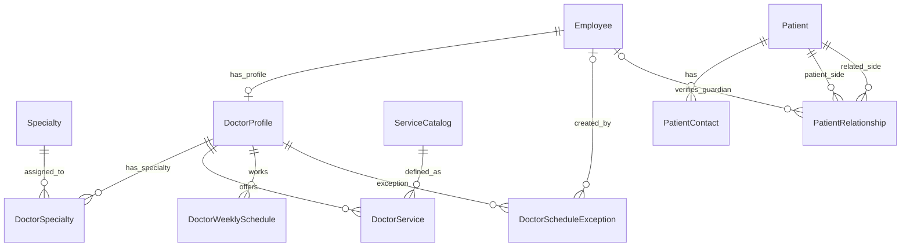

# MERUNO Phase 2A — Master Data and Patient Foundation

## Scope

This increment defines the first database domain models for the single-branch MERUNO clinic:

- Seven medical specialties and clinic employee records.
- Doctor profiles, specialty assignments, service offerings, weekly schedules, and schedule exceptions.
- Patient records, contact methods, and family relationships.
- A clinic-recorded legal-guardian designation with staff verification metadata.

It does **not** create authentication tables, patient login accounts, appointment records, encounters, clinical records, laboratory/radiology workflows, billing, migrations, or seed data. Explicit patient-data access grants are deferred until Phase 3 because they must be tied to authenticated identities and server-enforced permissions.

## Model inventory

| Model | Purpose | Important constraints |
| --- | --- | --- |
| `Specialty` | Clinic medical specialties | Unique code and name; active/sort index |
| `Employee` | Staff identity independent of login | Unique employee number; optional unique work email |
| `DoctorProfile` | Professional and public doctor details | One-to-one with employee |
| `DoctorSpecialty` | Doctor-to-specialty assignment | Composite primary key; one row per pair; at most one primary specialty per doctor (partial unique index in migration) |
| `ServiceCatalog` | Consultation/follow-up/other definitions | Unique code |
| `DoctorService` | Service offered by a doctor | Unique doctor/service pair; decimal price; positive duration |
| `DoctorWeeklySchedule` | Recurring work blocks | Supports split shifts; time and effective-date checks added in migration |
| `DoctorScheduleException` | Blocked time or extra hours | Absolute timestamp range; optional employee creator; end must follow start |
| `Patient` | Patient master record | Unique MRN; optional date of birth and gender |
| `PatientContact` | Phone/email methods | Contacts are not globally unique; one primary per patient/contact type (partial unique index in migration) |
| `PatientRelationship` | Directed family relationship and recorded guardian status | One directed row per patient pair; self-links forbidden; guardian verification metadata required when marked as legal guardian |

## Important design decisions

### Employee and doctor are separate

`Employee` represents a person working for the clinic. `DoctorProfile` holds doctor-specific information and is a one-to-one extension of the employee record. Authentication accounts and staff roles are not stored here; they are added in Phase 3 and linked to employees then.

### Specialty is many-to-many

A doctor can be assigned to more than one specialty. `DoctorSpecialty` is the explicit join model and carries `isPrimary`. A doctor may have zero or one primary specialty, never multiple primary specialties. PostgreSQL will enforce this with a partial unique index in the first migration:

```sql
CREATE UNIQUE INDEX "DoctorSpecialty_one_primary_per_doctor"
ON "DoctorSpecialty" ("doctorId")
WHERE "isPrimary" = TRUE;
```

The application must still require an appropriate primary specialty before publishing/book-enabling a doctor where the booking workflow needs one.

### Services and prices

`ServiceCatalog` stores service definitions. `DoctorService` stores the doctor-specific duration and price. Money uses `Decimal(10,2)`, never floating point. The current clinic currency is EGP (`currencyCode = 'EGP'`). Database checks will reject negative prices and non-positive service durations.

### Weekly schedule representation

`DoctorWeeklySchedule.startMinuteOfDay` and `endMinuteOfDay` are integer minutes after midnight in the clinic's configured time zone. For example, 09:30 is `570` and 17:00 is `1020`. Multiple rows for the same weekday allow split shifts.

The first migration must add CHECK constraints requiring:

- `startMinuteOfDay >= 0 AND startMinuteOfDay < 1440`
- `endMinuteOfDay > 0 AND endMinuteOfDay <= 1440`
- `endMinuteOfDay > startMinuteOfDay`
- `effectiveUntil IS NULL OR effectiveUntil >= effectiveFrom`

`DoctorScheduleException.startsAt` and `endsAt` are absolute instants stored as `timestamptz`; convert clinic-local schedule times using the clinic's configured time zone before persistence. The migration must enforce `endsAt > startsAt`.

This schema does not yet prevent overlapping weekly schedule rows or overlapping exception ranges. Scheduling services and later PostgreSQL range/exclusion constraints must address those conflicts before appointment booking is implemented. Do not claim concurrency-safe booking based only on this phase.

### Patient demographic data

`Patient.gender` uses the `PatientGender` enum and is nullable so a patient can be registered when the value is unknown or not supplied. `NOT_SPECIFIED` is an explicit recorded choice; `NULL` means no value has been recorded. Age is derived from `dateOfBirth` and must not be stored as a second, potentially stale value.

### Patient contact identity

Phone numbers and email addresses are intentionally not unique across the whole patient table. Family members may share a phone number or email. `normalizedValue` supports duplicate-candidate searches; it is not a patient identifier. Phone values should be normalized to a consistent international format and emails normalized to lowercase by the application before persistence.

The schema prevents repeating the same normalized contact for the same patient. The first migration must add a partial unique index so each patient has no more than one primary contact of a given type:

```sql
CREATE UNIQUE INDEX "PatientContact_one_primary_per_type"
ON "PatientContact" ("patientId", "type")
WHERE "isPrimary" = TRUE;
```

### Family relationship versus legal guardianship versus data access

`PatientRelationship.patientId` is the patient whose file records the relationship. `relatedPatientId` is the other person, and `relationshipType` describes that person's relationship to `patientId`. For example, if a child's file records their parent, `relationshipType = PARENT`.

The relationship is directed. The application must use a consistent canonical direction and must not create a second inverse row for the same real-world relationship unless a future requirement explicitly calls for it.

`isLegalGuardian` is separate from `relationshipType`: a parent is not automatically assumed to be a legal guardian, and a guardian may be another relative. A record may be marked as a legal guardian only after clinic staff have verified the authority. When marked, `guardianVerifiedAt` and `guardianVerifiedByEmployeeId` identify when and by which employee the verification was recorded. The first migration must enforce that these two fields are both present exactly when `isLegalGuardian = TRUE`.

**This flag does not grant portal access or medical-record access.** A family relationship, a guardian record, and permission to access a patient's data are three separate concepts. Scoped and revocable access grants will be designed in Phase 3 alongside authenticated user identities. Booking for another adult also remains separate from access to that adult's medical record.

### Referential integrity and deletion

Employee records referenced by doctor profiles or guardian verification are not hard-deleted. Deactivate employees instead. Patient records are also deactivated rather than hard-deleted once clinical/financial activity exists. The `Restrict` relations protect referenced employee and patient records; contact rows are dependent on their patient record.

## PostgreSQL constraints planned for the first migration

Prisma schema validation does not validate the following database-level business constraints. They must be included as SQL in the first reviewed migration:

```sql
ALTER TABLE "Employee"
  ADD CONSTRAINT "Employee_endedOn_not_before_hiredOn"
  CHECK ("endedOn" IS NULL OR "hiredOn" IS NULL OR "endedOn" >= "hiredOn");

ALTER TABLE "DoctorProfile"
  ADD CONSTRAINT "DoctorProfile_yearsOfExperience_nonnegative"
  CHECK ("yearsOfExperience" IS NULL OR "yearsOfExperience" >= 0);

ALTER TABLE "DoctorService"
  ADD CONSTRAINT "DoctorService_duration_positive"
  CHECK ("durationMinutes" > 0),
  ADD CONSTRAINT "DoctorService_price_nonnegative"
  CHECK ("price" >= 0);

ALTER TABLE "DoctorWeeklySchedule"
  ADD CONSTRAINT "DoctorWeeklySchedule_valid_minutes"
  CHECK (
    "startMinuteOfDay" >= 0 AND "startMinuteOfDay" < 1440 AND
    "endMinuteOfDay" > 0 AND "endMinuteOfDay" <= 1440 AND
    "endMinuteOfDay" > "startMinuteOfDay"
  ),
  ADD CONSTRAINT "DoctorWeeklySchedule_valid_effective_dates"
  CHECK ("effectiveUntil" IS NULL OR "effectiveUntil" >= "effectiveFrom");

ALTER TABLE "DoctorScheduleException"
  ADD CONSTRAINT "DoctorScheduleException_positive_range"
  CHECK ("endsAt" > "startsAt");

ALTER TABLE "PatientRelationship"
  ADD CONSTRAINT "PatientRelationship_no_self_link"
  CHECK ("patientId" <> "relatedPatientId"),
  ADD CONSTRAINT "PatientRelationship_guardian_verification_consistent"
  CHECK (
    ("isLegalGuardian" = FALSE AND "guardianVerifiedAt" IS NULL AND "guardianVerifiedByEmployeeId" IS NULL)
    OR
    ("isLegalGuardian" = TRUE AND "guardianVerifiedAt" IS NOT NULL AND "guardianVerifiedByEmployeeId" IS NOT NULL)
  );
```

The two partial unique indexes described above must be included in that migration as well. These SQL statements are migration design notes only; Update 07 does not execute them or modify PostgreSQL.

A future patient migration may add date-of-birth validity and scheduling overlap safeguards after the exact behavior is decided. Avoid CHECK constraints that rely on `CURRENT_DATE`, because time-dependent CHECK expressions do not remain self-updating as the date changes.

## ERD — Phase 2A



## What this increment does not do

- It does not connect to or modify PostgreSQL.
- It does not create or apply a migration.
- It does not seed the seven specialties or eight doctors yet.
- It does not create Better Auth users, sessions, roles, or permissions.
- It does not create patient access grants or portal access.
- It does not create appointment slots or booking records; those arrive in Phase 2B.
- It does not create clinical, laboratory, radiology, billing, or audit workflows.

## Local verification

After applying Update 07, run these commands one at a time from the project root:

```powershell
npm run db:validate
```

After validation succeeds:

```powershell
npm run db:generate
```

Then:

```powershell
npm run typecheck
```

`db:generate` writes to the ignored `generated/prisma/` folder. It does not modify database records. Do not run `prisma migrate dev`, `prisma db push`, or database reset commands as part of Update 07.
